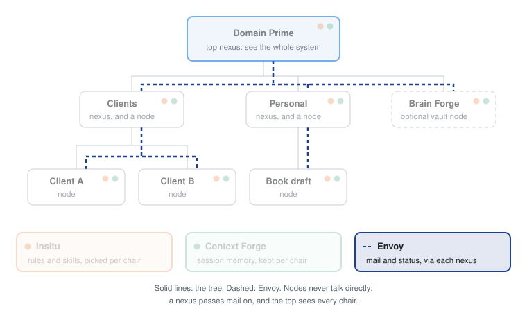

# Envoy

Envoy carries messages between walled-off AI projects and keeps one ranked board of priorities, with a local dashboard of everything that needs you.

## The problem

Keep your AI projects properly apart and each one works blind. It can't see what the others are doing, so it can't tell them anything either. Priorities live in your head, or in a list no agent reads. And when you sit down for the week, nothing shows you which project has slipped and which one is waiting on you.

## What you get

- **Messages without peeking.** A project posts a note; its line of work passes it on. No project writes into another project's files; mail goes through the nexus above them.
- **One ranked board.** Each line of work keeps a short, ranked list of what matters this week. Every chair under it sees the same board.
- **Drift caught for you.** Each project publishes a short status report, and Envoy checks it against the board. A project whose report doesn't reflect its board line gets flagged.
- **A dashboard that says who clears what.** A local page shows each chair as up to date, as housekeeping an agent can clear on its own, or as needing you. A board date that has passed, or a line a report doesn't reflect, needs you. A report that disagrees with its own file, or a note nobody has seen, is housekeeping. Waiting letters are listed without color. Every signal says how it clears, with the command ready to copy.
- **Privacy where you need it.** A sensitive chair's content stays hidden on the page until you show it, and mail crossing its walls stops at a gate for you to decide.

## A day with it

A made-up line of work, Clients, holds two projects: Client A and Client B. Client B is marked sensitive.

Monday you rank the Clients board: ship Client A's report by Thursday, then review Client B's contract. Both projects see that board when they ask what's next.

Tuesday, working in Client A, the agent finds a question only Client B can answer. It doesn't open Client B. It posts a mail note and leaves the letter in the Clients inbox, one level up. Only the Clients chair delivers letters down. Because Client B is sensitive, the note waits at a gate until you choose to deliver, hold, or set it aside.

Wednesday morning you open the dashboard. The board line for Client A's report says it is due tomorrow, in plain text. Client B published a status report last week that still says nothing about the contract, so that line shows as needing you, with the step that clears it. Its details stay hidden until you click to show them. Friday the report date passes with the line still on the board, and it turns amber.

## Part of Domain Prime

<picture>
  <source media="(prefers-color-scheme: dark)" srcset="docs/domain-prime-dark.svg">
  
</picture>

Envoy is one of four engines in [Domain Prime](https://github.com/srmackey/domainprime), a local-first system for running many AI projects as a tree. Projects can't see into each other. Envoy carries their messages, always through a nexus, and keeps the ranked board. Step in at the top and the dashboard shows the whole system. Envoy also runs on its own: point it at any folder with a roster and it works without the rest. Terms like chair, nexus, and sitrep are defined in the [glossary](https://github.com/srmackey/domainprime/blob/main/docs/glossary.md).

## How it works

Envoy gives an AI client a local bulletin: who belongs, what each one last published, and the mail notes between them.

It is not a wiki, not standing guidance, and not session briefs. It does not deliver inbox letters. Files on disk stay the record. The vault holds published sitreps and mail notes.

A clone can run it against any bulletin root. Wire it into a larger system, or use it on its own.

### Stack

- Python 3.11+, `uv`, FastMCP, Pydantic v2, PyYAML
- `MAP.md` and `FOCUS.md` at the bulletin root (`ENVOY_ROOT`). When that folder has `nexus.md`, that file is the roster, each nexus has its own `FOCUS.md`, and each nexus folder holds `_envoy/`.
- Vault JSON under `ENVOY_HOME` (default `~/.envoy`) when `nexus.md` is absent. Otherwise the records live in each nexus's `_envoy/`.
- Tests with pytest under `tests/`

## Setup

```bash
uv sync
uv run pytest
uv run envoy --root /path/to/bulletin
uv run envoy view --root /path/to/bulletin
```

While the server runs, it also serves a page on `127.0.0.1` port `4173`, so there is nothing else to start. Every host starts its own Envoy: the first one serves the page, and the others take over if it exits. `envoy view` serves the page by itself when no host is running Envoy.

The page leads with the chair you open: its Forefront, what on it needs you, and its record. The nexus it sits in stays beside it with one line for the housekeeping under it, its board, and whatever else needs you there, and every chair's state is in one tree. It reads the board, the roster, published sitreps, each chair's local status, pending inbox, and desk files, and, inside a Domain Prime tree, what a settle pass left in `settle-wait.md`. Viewing counts unseen mail notes and does not mark them seen. `/` jumps to a chair, `j` and `k` move, `s` shows sensitive chairs.

| Variable | Role |
|---|---|
| `ENVOY_ROOT` | Bulletin root (required; or pass `--root`) |
| `ENVOY_HOME` | Record store when the bulletin root has no `nexus.md` (default `~/.envoy`; or pass `--vault`) |
| `ENVOY_VIEW` | Set to `0` or `off` so the server does not serve the page |
| `ENVOY_VIEW_PORT` | Port the server uses for the page (default `4173`) |

Install: [`install/README.md`](install/README.md). The block is [`install/mcp.json.examples.md`](install/mcp.json.examples.md). Host files come from `platforms.yaml` next to `nexus.md`. With no environment file, user-global host config is left alone.

## Tools

Ten tools. The list and what each one changes are in [docs/tools.md](docs/tools.md).

Each tool sets `readOnlyHint`, `destructiveHint`, `idempotentHint`, and `openWorldHint`. None are open to the network. `note_list` writes an ack of shown the first time the intended chair lists a note, so it is not read-only. A nexus `now_view` lists that same mail and records the same ack. A node `now_view` only reads the board. The page counts unseen notes and does not record the ack.

On initialize the server returns a short operating note: every call sends `chair`, and `now_view` is the living board. That note lives in the server. This page does not repeat it.

How it is structured: [`DESIGN.md`](DESIGN.md). What moved: [`CHANGELOG.md`](CHANGELOG.md).

## Trust boundary

- Transport is stdio. The host starts a local process as the user who launched it.
- The page listens on `127.0.0.1` only. It reads the bulletin and the vault. It does not write them.
- Bulletin files live at `ENVOY_ROOT`. Map tools read and write `MAP.md` there. `now_view` reads `FOCUS.md`. The server reads a node's identity file and local status when a tool asks for them.
- Published sitreps and mail notes are JSON. Without `nexus.md` they live under `ENVOY_HOME` (default `~/.envoy`). With `nexus.md`, each nexus folder holds them in `_envoy/`.
- It does not write inbox letters. A letter is a file some other program puts there.
- It does not use the network and it does not take a credential.

The same boundary, and how to report a vulnerability, is in [SECURITY.md](SECURITY.md).

## Requirements

- Python 3.11+
- [uv](https://docs.astral.sh/uv/)
- FastMCP 2, over stdio

There is no published package. Clone the repository and run it from the checkout.

## Tests

Fixtures and examples use fictional chairs only. Do not publish real sitreps or letters into a shared vault from test runs.
